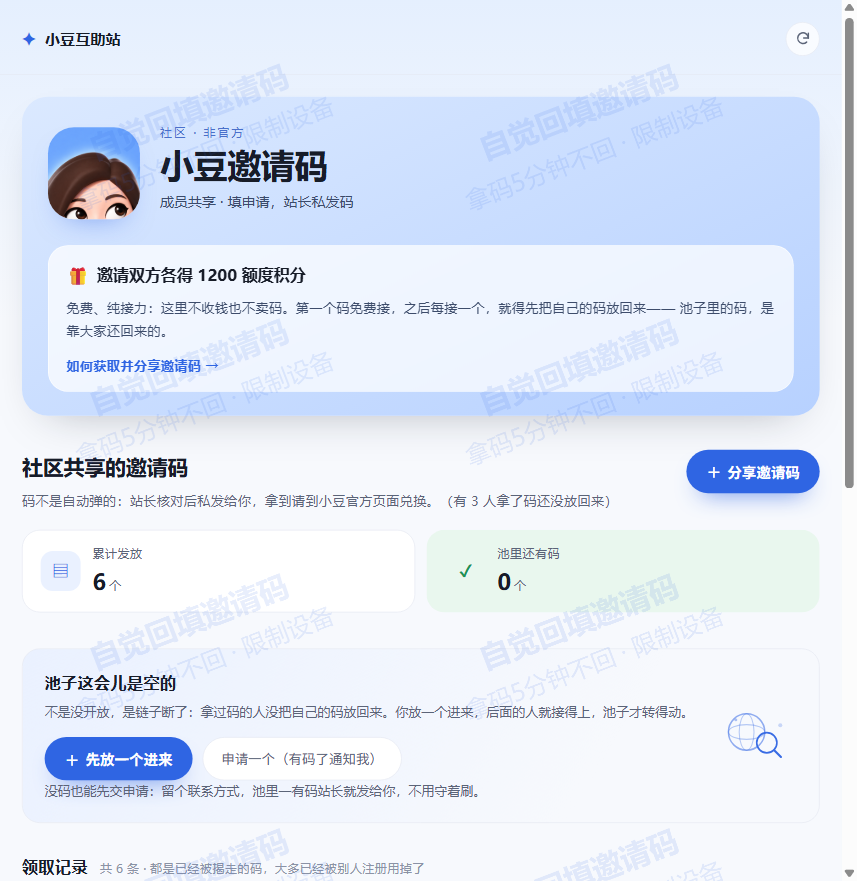
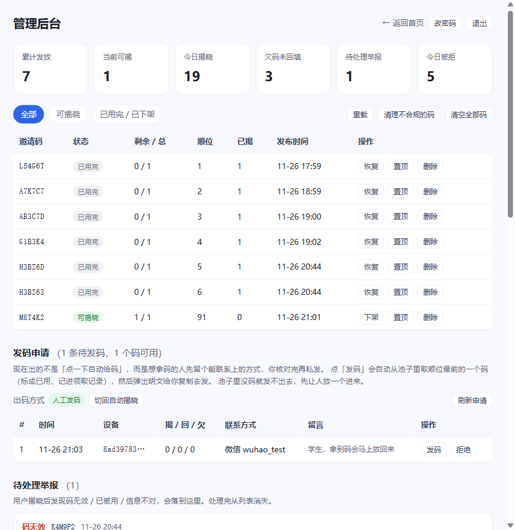
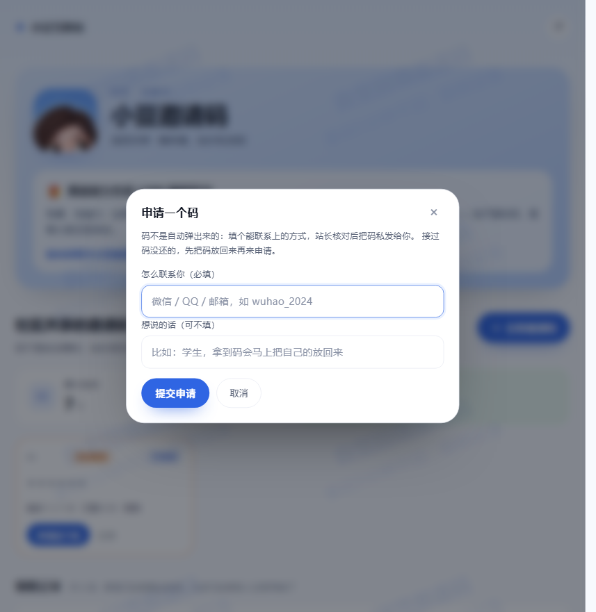

# 小豆邀请码互助站（申请制 · 默认人工发码）


<p>
  <a href="https://github.com/wwj5/xiaodou-hub/actions/workflows/pages.yml"></a>
  <a href="https://wwj5.github.io/xiaodou-hub/"></a>
  <a href="LICENSE"></a>
  
  
  <a href="https://github.com/wwj5/xiaodou-hub"></a>
</p>

**站点：https://wwj5.github.io/xiaodou-hub/**

社区互助用的邀请码共享站。核心是两件事：**不把邀请码挂在明面上**，以及**不让人拿了就跑**。

- 列表里只有遮罩和状态，爬虫扫页面也扫不到码；
- 默认是**申请制**：想拿码的人先填联系方式交申请，站长核对后手动私发。码没经过自动出码这一步，
  拿完就跑的人也就没有"拿了就走"的入口；
- 后台可以一键切回「自动揭晓」——那时点一下直接出明文，揭晓即标记已领取、扣减剩余次数、消耗每日名额。

> 非官方项目，与小豆官方无隶属关系。

<p>
  
  
</p>

<p>
  
</p>

> 非官方项目，与小豆官方无隶属关系。

## 一、跟 muse-invite-hub / BetterOPC 的关系

- 队列、队首优先、反馈、管理密钥这一套交互，参考 `WRM-FW/muse-invite-hub`<sup>①</sup>。
- 页面结构照 BetterOPC 的小豆邀请码页：蓝色渐变产品头卡（含「邀请双方各得 1200 额度积分」块）、
  「累计发放 / 当前可揭晓」统计块、卡片网格、空态提示、领取记录；今日揭晓额度不在页面上显示，用完直接拦在接口层。
- 「列表不给明文，点揭晓才出码」「揭晓即标记已领取」「今日揭晓次数用完就停」「北京时间 0 点重置」
  这一套信息与交互，同样来自那一页（原版是"点一下就出码"，本站默认已换成申请制）。
- 实现上换了更轻的组合：纯静态前端 + Supabase RPC，不需要 Vite、npm、服务器进程，
  GitHub Pages 直接托管，仓库本身就是部署产物。

## 二、功能

- **免费纯接力**：不收钱、不卖码。拿到码之后（自动模式下会弹一次「拿到了，接力一下」）提示把自己的码放回池子；
  接过几个码就在首页挂一条「接力中」提示，真去分享了就清零。
- **列表零明文**：`list_codes` 只返回 `mask`（``••••••``）与状态；申请制下明文只在后台点「发码」时出来，自动揭晓模式下才由 `reveal_code` 返回。
- **发出即标记**：不管人工发还是自动揭，码一发出去就变「已用完」、剩余次数归零，同一个人拿不到同一个码两次。
- **配额**：每天最多交 2 次申请（北京时间 0 点重置）；自动揭晓模式下另有「每人每天 2 次揭晓」的老限制。
- 发布：点「＋ 分享邀请码」弹窗提交，字段接受**邀请码本身或官方邀请链接**——链接里的
  `invite_code/inviteCode/code`、或路径里的码段会自动解析出来；也认「邀请码：XXXX」这种文本。
  **只收 6 位、字母和数字都有的码**：全字母、全数字、5 位、3 个字母或 3 个数字连在一起的、
  英文单词（OPENAI / CLOUD 之类）、含 91 / 78 / 13 / 27 的一律不收，前后端都会拦；同一个人最多保留 1 个可用码。
- 实时新码：15 分钟内放进来的码打「实时新码」标并置顶，列表按发布时间倒序，号码就是当前位次。
- 发码申请卡片：同一台设备在没处理完之前不能重复交；欠着码没还的人不让申请，先还再申。
- 队列顺位：管理员仍可把某个码置顶或插到指定位置，其余码自动顺延，也能一键重排 1..N。
- 列表只展示可揭晓的码（按发布时间倒序），已揭完的沉到「领取记录」，页面不做搜索框——少一个能探消息的口子。
- **申请制出码**（默认）：卡片按钮是「申请这个码」，点开填个联系方式，站长在后台核对后手动发码；池子空了也能先交申请，等有码再发。要回到「点一下自动给码」，后台可以一键切回自动揭晓（`admin_set_reveal_mode`），此时服务端的 reveal_code 会直接拒绝手动出码请求，并提示去点「申请这个码」。
- **欠码公示**：首页底部一个可展开的折叠区，列出欠着码没还的设备——大概在哪个城市、用的是什么设备、欠几个、最后什么时候动过。放回一个码就从表上消失。地址只到城市、IP 只留前两段，不公开完整 IP。
- 领取记录是卡片网格：每张卡显示**已揭走的明文**（下架的打「已下架」）、「N 次揭晓」、时间和复制按钮，
  方便后来的人核对"这个码到底还在不在池子里"。
- **在线客服**：首页右下角一个圆形按钮，点开就能给站长留言（码怎么用、为什么被限制、申请一直没回，都可以）。
  站长不一定在线，消息先落库；后台「客服聊天」里一页看完会话列表 + 未读红点，回完访客页面 6 秒拉一次，不用刷新。
  一台设备一个会话，昵称可留可不留，后台能顺带看到那台设备在城市与机型档案里的记录。
- 反馈：无效 / 已用掉 / 信息不对 / 其他，写进 Supabase `feedback` 表，不自动改状态。
- 管理密钥：只存在管理员自己浏览器里，可改剩余次数、顺位、状态；管理端能看到明文。
- 本机记录：你揭晓到的码存在本地浏览器，刷新后还能看到，也可以再复制。
- 开场公告：首页打开先弹一次「接力说明（公告）」，讲清码只送不卖、拿了要放回来；
  可勾「今天不再显示」，按北京时间当天生效，次日自动恢复。
- 玩法说明收进弹窗：页面只留一句原理和「看完整说明」按钮，7 个步骤（先拿 3 步 / 再放回 4 步）
  两栏排在弹窗里，底部是免责与接力规则；首屏链接、页脚「使用说明 / 免责声明」都是同一个入口。
- 空池文案：池子空了不是「没开放」，而是提示接力断了，引导「先放一个进来」或直接看说明。
- 页面水印：一层斜向平铺水印，文字（「自觉回填邀请码 / 拿码不回 · 限制设备」）和透明度都在后台改，
  前端用 canvas 现场画，不依赖图片；页脚还有一句把话挑明：水印就是这个意思。
- 深浅色跟随系统，移动端无横向溢出；没配 Supabase 时是演示模式。

## 三、部署到 GitHub Pages

1. 新建仓库，把这几个文件推上去：

   ```
   index.html  styles.css  app.js  config.js  admin.html
   assets/  supabase/schema.sql  .github/workflows/pages.yml  README.md
   ```

2. Settings → Pages → Build and deployment → Source 选 **GitHub Actions**。
   推到 `main` 后自动发布，地址形如 `https://<用户名>.github.io/<仓库名>/`。

3. 不用任何构建步骤，页面全是相对路径，子目录部署也能直接开。

## 四、接上 Supabase（全站共享 + 真揭晓）

1. 建一个 Supabase 免费项目。
2. SQL Editor 里把 `supabase/schema.sql` 整段执行一次。
3. 设管理密钥（同一编辑器里执行，换成你自己的长字符串）：

   ```sql
   insert into public.app_settings (id, admin_token_hash)
   values (true, encode(sha256(convert_to('换成你自己的长密钥', 'UTF8')), 'hex'))
   on conflict (id) do update
     set admin_token_hash = excluded.admin_token_hash, updated_at = now();
   ```

4. Settings → API 里复制 **Project URL** 和 **anon public key**（不要 service_role），填进 `config.js`：

   ```js
   window.HUB_CONFIG = {
     supabaseUrl: "https://xxxx.supabase.co",
     supabaseKey: "eyJhbGciOi...",
     dailyReveals: 2,
     ...
   };
   ```

5. 推上去，Pages 自动重建。首页状态会变成「已连接」。

> 只填空配置时站点是**演示模式**：发布/揭晓都能用，但数据只在这台浏览器里。

## 五、为什么这样不容易被秒

| 手段 | 作用 |
|---|---|
| 列表零明文 | 任何人抓 `list_codes` 拿到的只有 `••••••`，脚本没有可抢的东西 |
| 默认人工发码 | 明文只在后台点「发码」时返回给管理员，由他手动私发；自动揭晓模式下才由 `reveal_code` 一次性返回 |
| 揭晓即扣减 | 别人揭走后码就被标记，后来者看到「已被揭」 |
| 配额 | 同一个 visitor 每天最多 2 次申请 / 揭晓，抓不到批量结果 |
| 服务端限流 | 发布 1 条/人、全站 30 条/10 分钟；申请 2 次/天；自动揭晓 30 次/小时 |
| RLS + RPC | `anon` 对表零权限，只能通过函数做受限操作 |

## 六、诚实的限制

- 身份是「浏览器指纹」哈希：清 localStorage 不会变成新访客，但换浏览器/换设备仍然是新身份（匿名架构的上限）。
  同型号同系统设备存在指纹碰撞的可能，届时两个人会共用一份额度，属于宁可误伤不漏放的选择。
- 接力硬规则：第一个码免费接，之后每接 1 个必须放回 1 个**仍在池中未被下架**的码；发废码占位被发现后解锁自动失效。
- 同一个码被 2 个不同访客举报，会自动置为 `expired` 摘出池子，等管理员在后台核验；不用人工盯。
  要更强的身份约束就得上 Supabase Auth（邮箱 OTP）或 Cloudflare Turnstile，前端改动不大。
- 邀请码本身仍可能被别人抢先兑换；申请制能控制"发给谁"，但不能保证你发的码还没被原主人用掉。
- 人工发码的代价是**你得在线**：池里没码就发不出去，来的人也得等你处理；想回到"谁点谁拿"，后台一键切回自动揭晓。
- **领取记录公开明文**：码一被揭走就露出明文，如果揭走的人还没去注册，别人有机会抄走抢先。
  想收紧的话，可以让「揭走后 N 分钟内仍遮罩、之后才露明文」，改 `hub_card_public` 的 `codePlain` 条件即可。
- **格式规则可能误杀**：3 个字母或 3 个数字连在一起就拒收，能挡住 `ABCDEF`、`AB1234` 这类假码，
  但真码里偶尔也有三连的情况（线上已经误伤过一个）。拿到真实反馈就放宽那条，别让规则比假码更贵。
- `list_codes` 的 `p_query` 参数还在（能验证"池里有没有这个码"，拿不到明文），但页面已经没有搜索框；
  真要彻底关掉，把它固定传空字符串或在函数里删掉这段过滤即可。
- 管理密码是高权限凭据，只应放在管理员自己的设备上，别进仓库、别发群。
- **IP 归属地不准，也不该被当成证据**：挂代理就是代理的地址，移动网络常只到省会，校园网、公司网几十号人共用一个出口。
  公示里写「某某市」，只是给人一个「这台设备大概在哪」的印象，不能拿去认人、更不能拿去挂人。
- **公示只对"从现在起"的设备有效**：功能上线前产生的欠账，库里没有任何 IP 记录，只能一直显示「地址未知」——
  除非当事人再打开一次本站（首页加载会补记一次，30 分钟节流）。想清掉旧账，还得靠催还或直接限制。
- 设备档案会一直涨：每个新设备一行，只有来访次数和最后活跃在变。嫌多就定期清 `visitor_meta` 里久未出现的行。
- Supabase Security Advisor 仍会把「anon 可执行 SECURITY DEFINER」标成警告，这是匿名 RPC 架构必然提示。

## 七、当前线上实例

| 项 | 值 |
|---|---|
| 站点 | https://wwj5.github.io/xiaodou-hub/ |
| 仓库 | https://github.com/wwj5/xiaodou-hub （public） |
| Supabase 项目 | `cusioozwyyrdghgvaaqw` · 组织 `xiaodou` · 区域 Southeast Asia (Singapore) · FREE |
| 后端 URL | https://cusioozwyyrdghgvaaqw.supabase.co |
| 前端配置 | `config.js` 里 `supabaseUrl` + anon key（anon key 是公开可暴露的，RLS 兜底） |
| 管理密码 | 只写在本地 `.supabase-keys.txt` 的 `admin_key` 一行（已 gitignore，不进仓库） |
| 数据库密码 | 只写在本地 `.supabase-db-password.txt`（已 gitignore）；丢了可在 Dashboard → Settings → Database 重置 |

改代码后 `git push origin main`，GitHub Actions 自动重跑并发布，约 30 秒上线。

## 八、管理后台

独立页面 `/admin.html`（首页页脚「管理入口」进入，`noindex`，只靠密码把门）：

- 版式是左侧深色导航 + 白色顶栏 + 卡片内容区，左栏一列切页（仪表盘 / 邀请码 / 发码申请 / 客服聊天 /
  接力账本 / 举报 / 设备档案 / 被拒收录 / 水印），窄屏自动收成汉堡抽屉；待办数量在左栏亮红点。

- 输入管理密码 → `admin_verify` 校验，密码只存 sessionStorage，关浏览器即失效；
- 六张统计卡：累计发放 / 当前可揭 / 今日揭晓 / 欠码未回填 / 待处理举报 / 今日被拒；
- **仪表盘图表**（`admin_charts`）：近 N 天（默认 7）的折线图看揭晓 / 发布 / 申请三条线走成什么样，
  柱状图看每天新来几台设备；纯 canvas 手画，不引任何图表库，宽屏两图并排、窄屏自动堆叠，窗口变化会自己重画；
- **库里的表**（`admin_tables`）：把库里 11 张表的记录数按多少排出来，附一句「这张表干什么的」，
  用来快速判断哪张表在涨、哪张一直空着；
- **发码申请**（`admin_requests` / `admin_send_code` / `admin_resolve_request`）：待发码列表带「揭/回/欠」和联系方式，点「发码」自动取池里顺位最前的码、标成已用、记进领取记录，明文弹出来可复制；也能拒绝。顶部可切「人工发码 / 自动揭晓」；
- 全量码表（明文、状态、剩余/总、顺位、已揭、发布时间），每行可「下架 / 恢复 / 置顶 / 删除」；
- 待处理举报列表，可「标记已处理」，或「下架该码并处理」一键联动；
- 右上「改密码」调 `admin_set_key`（新密码 ≥ 8 位），改完立刻生效；
- **接力账本**（`admin_ledger`）：按设备指纹列出「揭走了哪些码 / 放回了哪些码 / 揭几回几 / 欠几个 / 最后活跃 / 状态」，
  两边对不上的那条就是欠的；欠码的排最前，可勾「只看欠码的」，一键导出 CSV（含两组码）；
- **设备限制**（`admin_block` / `admin_unblock`）：按住欠码不放的设备，限制后它再点「揭晓」会被
  `reveal_code` 直接拒绝（提示先把欠的码还回来），随时可解除；
- **超时自动锁**（`admin_set_autoblock`）：接过码超过 N 分钟没回填的设备自动限制（默认 5 分钟，0 关闭），
  回填成功只清自动限制，后台可按人改；
- **清理不合规的码**（`admin_purge_bad`）：先列出会被处理的码，确认后统一下架（`status='expired'`，
  保留码和领取记录，误杀了还能在码表里「恢复」）；判定函数和发布校验共用同一个 `hub_code_problem`，
  码表里也给不合规的行挂「不合规」标签；
- **被拒收录**（`admin_rejects`）：所有没通过格式校验的提交都记在 `reject_log`（只留 7 天），
  带「提交的码 / 为什么不收 / 设备短指纹 / 时间」，可按原因筛选、看各原因的条数、一键清空——
  用来判断哪条规则在误杀真码。
- **设备档案**（`admin_meta` / `admin_set_cities`）：每台来过本站的设备一行，显示设备短指纹 + **机型**、
  完整 IP、脱敏 IP 段、解析出的城市、浏览器标签、最后活跃（带来访次数）。**进这一页就自动补城市**，不用手点：
  串行、每条隔 500ms，接口按 ipwho.is（中文）→ ip.zxinc.org（中文）→ ipapi.co（英文）逐个降级，解析到就写回库里。
  实测 ipwho.is 对同一出口 IP 会 429，所以后面留了两个备用源。
- **页面水印**（`admin_set_watermark`）：一个多行框填首页那层斜向水印（最多两行、每行 40 字，换行就回车一下，写完再按回车直接保存），下面是透明度滑块（0–0.35），
  保存即生效、不用重新部署；前端用 canvas 现场画成平铺图，还能一键恢复默认。
- **客服聊天**（`admin_chat_list` / `admin_chat_fetch` / `admin_chat_reply` / `admin_chat_close`）：
  左边一列是会话（昵称或设备短指纹 + 城市 + 机型 + 最后一句 + 未读数），点开右边出完整对话，
  回车换行、Ctrl+Enter 发送，能把会话「结束」或重新打开（结束只是挡住访客再发，记录不删）。

> 账本只认前端算出的匿名设备指纹（`sha256('xd-hub:' + token)`），**不采集 IP、不采集姓名或手机号**，
> 后台也看不到任何可反查真人的信息；页面公开处只给聚合数字（「有 N 人拿了码还没放回来」），不点名。

对应 RPC：`admin_list`、`admin_delete_code`、`admin_clear_codes`、`admin_resolve_report`、`admin_set_key`、
`admin_ledger`、`admin_block`、`admin_unblock`、`admin_settings`、`admin_set_autoblock`、`admin_rejects`、
`admin_clear_rejects`、`admin_set_watermark`、`admin_purge_bad`、`admin_set_reveal_mode`、`admin_meta`、`admin_set_cities`、`admin_chat_list`、
`admin_chat_fetch`、`admin_chat_reply`、`admin_chat_close`、`admin_tables`、`admin_charts`（都先过 `hub_require_admin`，
anon 可调但没密码就是「管理密码不对」）。

后台里凡是成列的数据（码表 / 申请 / 举报 / 账本 / 设备 / 被拒）都是真表格：短列不换行、长列
（留言、限制原因）在格子里限宽换行，窗口窄到装不下时整块横向滚动，不会再把一个字挤成一行。

## 九、本地预览

```bash
python -m http.server 8787
# 打开 http://127.0.0.1:8787
```

## 十、表结构速览

| 表 | 作用 |
|---|---|
| `invite_codes` | 主表：明文码、状态、剩余次数、已揭次数、队列顺位、发布者哈希 |
| `reports` | 揭晓记录：去重 + 每日配额 + 「每人每天 2 次」计数 |
| `publish_log` | 发布流水，用于全站限流 |
| `feedback` | 反馈收件箱 |
| `visitor_blocks` | 被限制的设备指纹：`kind` 区分 manual（人工/欠码）与 auto（超时自动锁） |
| `reject_log` | 被拒收录日志：提交的码、拒收原因、设备短指纹，只留 7 天 |
| `app_settings` | 单行管理密码的 SHA-256、超时分钟数、出码方式（`reveal_mode`：manual 人工发码 / auto 自动揭晓）、水印两行文字与透明度 |
| `reveal_requests` | 发码申请：设备哈希、联系方式、留言、状态（open / sent / rejected）、发出的码 |
| `visitor_meta` | 设备档案：完整 IP（只在后台）、脱敏 IP 段、城市、浏览器短标签、设备机型（`device_model`，从 UA 抠，安卓到具体型号、iPhone 只到系列）、来访次数与首末时间 |
| `chat_threads` | 客服会话：一台设备一条（`visitor_hash` 唯一）、昵称、城市、状态（open / closed）、两边未读数、最后活动时间 |
| `chat_messages` | 客服消息：所属会话、`side` 区分 visitor / admin、正文（500 字内）、时间，删会话级联删 |

## 十一、已验证

- 线上 Supabase 实测（anon key 直调 RPC）：`list_codes` 只给 `mask`、`publish_code` 成功入队、
  `reveal_code` 出码并让 `revealedCount` 从 0 → 1。
- 嵌入式 PostgreSQL 实跑 `schema.sql`：列表返回不含 `code` 键、`reveal_code` 返回明文并扣减次数、
  第三次揭晓被每日配额拦住、同码重复揭晓被拦、`anon` 只能拿到遮罩、管理端可见明文。
- 接力硬规则实测：第一个码免费接 → 接第二个被拦（未放回）→ 发布自己的码后解锁。
- 欠码公示实测：一台设备用 iPhone 微信 UA 触发写接口 → `visitor_meta` 记到 `36.142.*.*` + 「微信 · iPhone」→ 后台「补全城市」走 ipwho.is 解析成「北京市 北京」→ 首页折叠区正确显示城市、IP 段、设备、欠码数。
- 申请制实测：申请 → 后台出现待发码 → 点「发码」取池里顺位最前的码、标成已用、记进领取记录、明文复制，申请状态转 sent；
  切 `manual` 后直接调 `reveal_code` 会报错拦住，绕过页面也拿不到码。
- 公告/说明弹窗实测：勾「今天不再显示」后当天不再弹（`localStorage` 记北京时间日期）；
  「去回填邀请码」直接打开提交框并聚焦；公告里的「看 4 步说明」关公告、直接弹说明。
- 格式校验实测 13 组样例：6 位「字母+数字」放行，全字母 / 全数字 / 5 位 / 三连字母 / 三连数字 /
  `OPENAI` 这类英文词 / 含 91·78·13·27 的全部拒收，拒收原因进 `reject_log`。
- 实时新码实测：15 分钟内发布的码打橙标置顶，`hub_card_public` 排序为 `(fresh) desc, created_at desc`。
- 接力账本实测：每行的「揭走的码 / 放回的码」与 `reports`、`creator_hash` 对得上，欠 1 的那台显示为欠码并被限制。
- 清理不合规实测：dry run 只列清单；`p_apply=true` 后统一改 `expired`，不删行、不删领取记录。
- 水印后台实测：把文字与透明度改到「测试水印一号 / 0.07」，首页立即变化，`admin_set_watermark` 可一键恢复默认。
- 在线客服实测：首页浮窗发一条 → 后台会话列表出现未读 1 → 点开看到完整对话 → 后台回一条 → 访客端拉到；
  后台切页、未读红点、结束会话都验过；`chat_send` 每分钟 8 条防刷、关闭的会话拒发。

## 十二、许可

MIT，见 [LICENSE](LICENSE)。代码可以拿去改，改成你自己社群用的站也随意；但要保留版权声明，
并且别把「小豆」「豆包」这些名字和 logo 拿来暗示官方授权。


